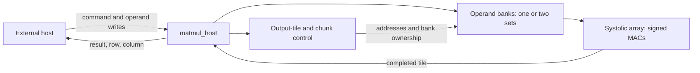

# Tiled Matrix-Multiplication Accelerator

A SystemVerilog accelerator computing **C[M,N] = A[M,K] × B[K,N]** with a
parameterized output-stationary systolic array. The project compares
single buffering and double buffering with the same compute array,
serialized host interface, and workloads.

On the default 4×4 array, double buffering reduces the 6×35 by 35×5
workload from **1,422 to 1,230 cycles (13.5%)**. Generic mapped cell count
increases from **21,576 to 23,819 (10.4%)**.

The completed deliverable includes RTL, an independent mathematical
reference, component and system tests, reproducible cycle measurements,
strict lint, and generic synthesis. Results describe simulation cycles
and generic logic mapping, not physical-device performance.

## Design

- Signed 8-bit operands, signed 16-bit products, and signed 32-bit sums.
- Default 4×4 array and 16 entries per operand bank.
- Output tiling and K chunks support matrices larger than the array or banks.
- Partial tiles use zero-padded input banks and emit only valid results.
- One operand write and one result transfer per clock through ready/valid ports.
- Synchronous reset, compute stalls, and output backpressure.
- Optional double buffering overlaps the next K-chunk load with computation.



Set `DOUBLE_BUFFER=0` for the single-buffer baseline or `DOUBLE_BUFFER=1`
for overlapping K chunks. The default is 0; host ports are identical.
See the [architecture](docs/architecture.md) and
[host protocol](docs/host-interface.md) for the complete contracts.

## Measured comparison

Depth is 16, the array is 4×4, and the host introduces no deliberate pauses.

| A × B dimensions | Single cycles | Double cycles | Cycle reduction |
|---|---:|---:|---:|
| 4×16 · 16×4 | 173 | 173 | 0.0% |
| 6×35 · 35×5 | 1,422 | 1,230 | 13.5% |
| 8×32 · 32×8 | 1,308 | 1,212 | 7.3% |

A single chunk has nothing to overlap. Multi-chunk workloads benefit,
but the one-byte-per-clock input port still limits throughput.
The [results discussion](docs/results.md) explains the tradeoff and
includes the rectangular-array comparison.

## Reproduce

Run commands in Ubuntu/WSL from the repository root.

The simulation environment uses Icarus 12.0, cocotb 2.1.0, GNU Make 4.4.1,
and Verilator 5.032 for lint. Generic synthesis uses OSS CAD Suite
2026-10-19, Yosys 0.70+157 (af9f71e51), with the slang frontend.

For a fresh checkout, install the simulation prerequisites and create the
isolated Python environment:

```bash
sudo apt update
sudo apt install git make iverilog verilator python3-venv libpython3-dev
python3 -m venv .venv
source .venv/bin/activate
python -m pip install -r requirements.txt
```

See [synthesis setup](docs/synthesis-setup.md) for the separately installed
tool bundle. Package versions depend on the distribution; the versions
above identify the measured environment.

Run the complete regression:

```bash
bash scripts/regression.sh
```

It activates the project virtual environment, runs lint and simulations
sequentially, verifies the saved performance snapshots, and synthesizes
both modes. It stops on any failure and saves logs and test-result XML
under `tests/sim_build/regression/`.

By default it uses `~/tools/cad-20261019/oss-cad-suite/environment`.
Set `OSS_CAD_ENV` to use a different installation location. The suite is
activated only inside synthesis subprocesses, preserving the simulation tools.

Individual commands are also available:

```bash
source .venv/bin/activate
make -C tests -f Makefile.host
make -C tests -f Makefile.double
make -C tests -f Makefile.perf
make -C tests -f Makefile.perf_double
```

## Verification and scope

System tests cover 4×4/depth16 and 2×3/depth16, depth1, and depth3.
Checks include signed extremes, partial tiles, multi-chunk sums, invalid
commands and writes, stalls, result stability, reset/recovery, and both
orders of load/compute completion. All measured outputs are checked
against the independent reference.

Both modes pass strict lint and generic synthesis structural checks.
Operand memories are mapped to registers and logic in the recorded flow.
No FPGA resource, physical area, power, or maximum-frequency measurement
is claimed. The Icarus 1×1-array build hits an elaboration assertion and
is outside the verified configurations; a 1×1 matrix on a larger array is tested.

## Repository guide

| Location | Contents |
|---|---|
| `rtl/` | Processing elements, banks, controllers, and host wrapper |
| `tests/` | cocotb tests, independent reference, and simulation Makefiles |
| `scripts/` | Regression, lint, and synthesis entry points |
| [Architecture](docs/architecture.md) | Dataflow, module organization, and arithmetic |
| [Results](docs/results.md) | Performance and generic hardware comparison |
| [Verification](docs/verification.md) | Coverage and regression behavior |
| [Host interface](docs/host-interface.md) | Commands, loading, results, and reset |
| [Double buffering](docs/double-buffering.md) | Ownership, overlap, and measurement details |
| `docs/results/` | Recorded JSON measurements and synthesis reports |
