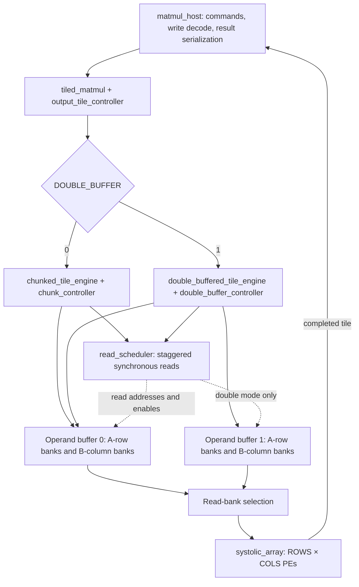

# Architecture

The accelerator computes signed integer matrix products using one
output-stationary systolic array. A PE holds one output element's partial
sum while A values move right and B values move down.

## Module organization

This diagram shows the two selectable implementations. Only the selected
branch is elaborated. Each implementation has one scheduler and one array;
single mode has one operand set and double mode has two.

| Module | Responsibility |
|---|---|
| pe | Signed MAC, accumulator, registered operand/valid forwarding |
| systolic_array | Connects the PE grid with A moving right and B moving down |
| operand_bank | Synchronous registered read and independent write |
| operand_buffer | A bank per array row and B bank per array column |
| buffered_array | Single operand set connected to the array |
| read_scheduler | Issues skewed bank addresses and drains the pipeline |
| tile_engine | Single-buffer computation for one K chunk |
| chunk_controller / chunked_tile_engine | Sequential loading and computation across K chunks |
| double_buffer_controller / double_buffered_tile_engine | Two-buffer ownership and concurrent loading/computation |
| output_tile_controller | Row-major output-tile traversal and result acknowledgment |
| tiled_matmul | Captures command dimensions and selects the chunk engine |
| matmul_host | Ready/valid command, serialized write, and serialized result interface |

## Arithmetic and dimensions

Inputs are signed 8-bit integers from -128 through 127. Each multiplication
produces a signed 16-bit product, explicitly sign-extended before adding
to the signed 32-bit accumulator. Accumulators clear once per output tile
and retain sums across K chunks.

Default M and N command fields are 16 bits: 1 through 65535. K is 17 bits:
1 through 131071. The largest positive product is 16384, and
131071 × 16384 = 2147467264 fits signed 32-bit range. The most negative
product is -16256, so the negative bound also fits. The host rejects zero
dimensions. These are representable interface limits, not a claim that
every maximum-size workload was simulated.

The standalone PE uses fixed-width addition; callers outside the host
contract must respect its accumulator range.

## Tiling and storage layout

An output tile covers at most ROWS rows and COLS columns. Every K chunk
contains at most DEPTH terms per dot product. For local bank address q:

- A bank r stores A[tile_row+r][k_offset+q].
- B bank c stores B[k_offset+q][tile_col+c].
- Inactive edge banks receive zeros.

Default single-buffer operand capacity is (4+4) × 16 × 8 = 1024 bits.
Double mode has 2048 bits. The external host supplies operands and stores
the complete output matrix; the accelerator stores one tile of sums.

## Enabled-edge timing

For an array without the operand-memory stage, PE (r,c) processes term k
at enabled edge 1+r+c+k. With registered bank reads, the scheduler issues
A-bank address t-r and B-bank address t-c when those indices are in range.
The complete buffered chunk uses K_chunk+ROWS+COLS-1 enabled advances,
including read latency and drain.

step freezes the scheduler, buffer-valid pipeline, PE forwarding, and
accumulators together. Loading, command acceptance, and result handshakes
are independent of step. Reset is synchronous and aborts the whole operation.

## Buffer ownership

Single mode loads a chunk, computes it, and repeats. Double mode loads
chunk n+1 into the opposite buffer while chunk n computes. It swaps only
after both load completion and compute drain. A full next buffer waits
safely through a compute stall; a drained array waits for a slow loader.

The load-request metadata describes the chunk being loaded. Its length
is stored separately from the active scheduler's K length. Buffer selection
is internal to the engine. K chunks overlap within a tile; output tiles
advance only after the preceding tile's results are accepted.

See [double-buffer control](double-buffering.md) for state and ownership
details, [PE behavior](pe-contract.md) for edge priorities, and
[host transfers](host-interface.md) for the external protocol.
